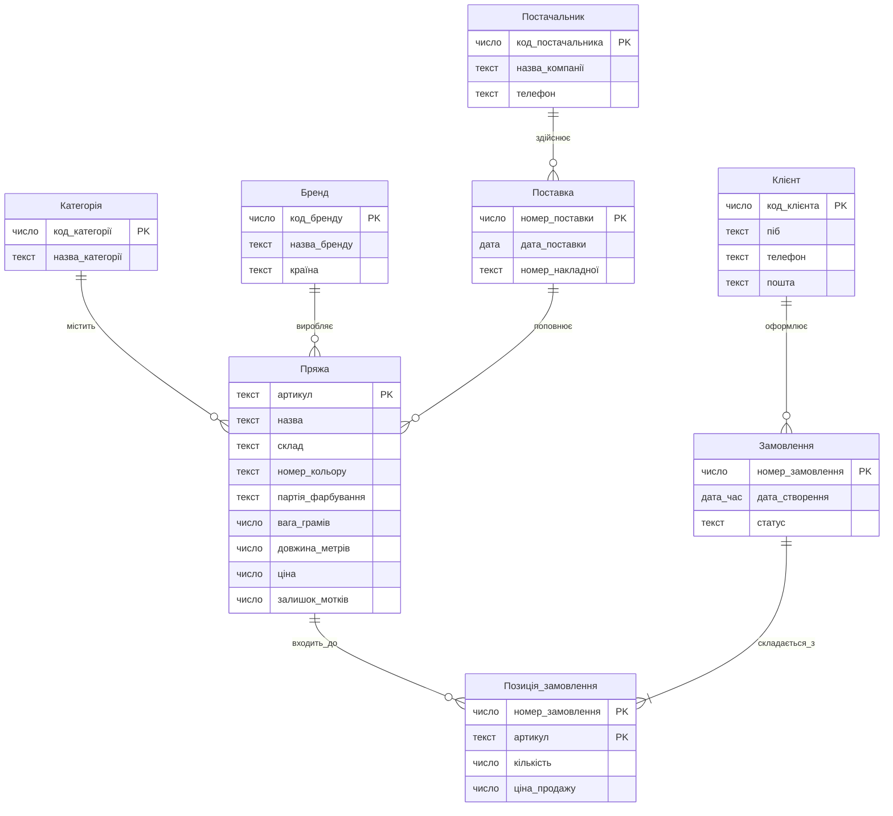
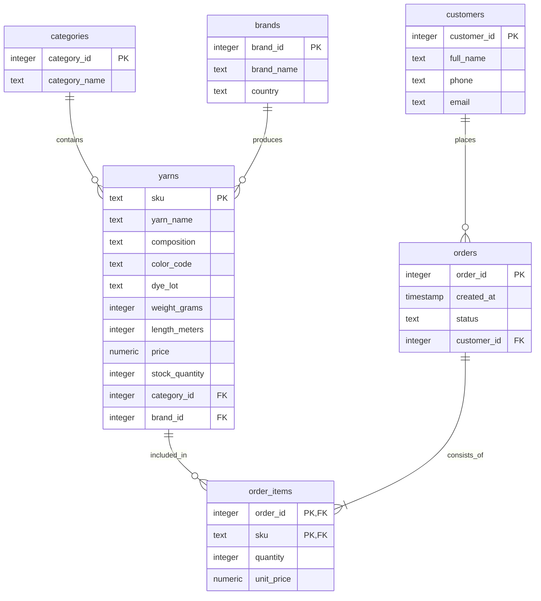

# Лабораторна робота №1. Моделювання предметної області та створення схеми бази даних

Виконавець: Колеснікова Катерина, СТСА-25-1

Предметна область: Магазин пряжі та товарів для в’язання

<!--
Шаблон звіту. Скопіювати як lab-01/README.md і заповнити всі розділи.
Вимоги до кожного розділу - у методичних вказівках до роботи №1.
Коментарі-підказки на кшталт цього перед здачею можна видалити.
-->

## 1. Предметна область

<!-- 3-5 речень: що це за бізнес, які події відбуваються в часі, які рішення в ньому ухвалюють. -->
Магазин пряжі та товарів для в’язання — роздрібний та онлайн-бізнес, що займається закупівлею пряжі різних виробників і складів, обліком залишків (за партіями фарбування та кольорами) і продажем товарів клієнтам

Події в часі: надходження нових поставок пряжі від постачальників,
 реєстрація нових клієнтів,
 оформлення замовлень,
 списання мотків зі складу під час продажу,
 зміна статусів замовлень

Рішення, що ухвалюються: контроль залишків конкретної партії кольору (щоб клієнт міг докупити пряжу одного відтінку),
 формування закупівель у постачальників,
 аналіз популярності брендів і складів пряжі

## 2. Бізнес-правила

<!-- Не менше восьми правил; схемою перевіряється щонайменше пʼять. -->

| № | Правило | Де перевіряється | Обмеження або обґрунтування |
|---|---|---|---|
| 1 | Якщо створюється категорія товарів, то її назва має бути заповнена й унікальною | схема | `NOT NULL`, `UNIQUE` на стовпці `category_name` |
| 2 | Якщо додається товар (артикул пряжі), то його ціна за моток і вага мотка (у грамах) повинні бути більшими за нуль | схема | `CHECK (price > 0), CHECK (weight_grams > 0)` |
| 3 | Якщо додається позиція в замовлення, то кількість замовлених мотків повинна бути цілим числом, більшим за нуль | схема | `CHECK (quantity > 0)` |
| 4 | Якщо замовлення містить оформлені позиції або за клієнтом закріплені замовлення, то видалити такого клієнта чи товар із бази неможливо (для збереження фінансової історії | схема | `REFERENCES ... ON DELETE RESTRICT` |
| 5 | Якщо видаляється замовлення, то всі його рядки (позиції замовлення) повинні видалятися автоматично разом із ним | схема | `REFERENCES ... ON DELETE CASCADE` |
| 6 | Якщо у клієнта не вказано електронну пошту, запис усе одно дозволяється, але якщо пошта вказана — вона не може повторюватися в інших клієнтів | схема | `UNIQUE` (без `NOT NULL`) на стовпці `email` |
| 7 | Якщо клієнт оформлює замовлення, то система перевіряє, чи вистачає мотків обраної партії фарбування на складі, і зменшує залишок | програма | Логіка бізнес-транзакції (перевірка залишків при оформленні виконується на рівні застосунку) |
| 7 | Якщо сума замовлення клієнта перевищує 3000 грн, то йому автоматично надається персональна знижка 5% на наступні покупки | програма | Динамічний розрахунок знижок і маркетингових акцій реалізується в коді застосунку |

## 3. ER-модель

<!--
Концептуальна модель: назви українською, загальні типи (текст, число, дата, дата_час, логічне). Ідентифікатор - PK.
Кардинальність: || рівно один, |o нуль або один, }| один або багато, }o нуль або багато
(з правого боку звʼязку - дзеркально: ||, o|, |{, o{).
-->



### Сутності

- **Категорія** - класифікатор типів пряжі (вовна, бавовна, акрил, змішана)

- **Бренд** - торгова марка виробника пряжі та країна виробництва

- **Пряжа** - конкретна товарна позиція (артикул) із зазначенням складу, кольору, партії фарбування та ціни

- **Клієнт** - покупець магазину пряжі, який реєструється для оформлення замовлень

- **Замовлення** - факт покупки товарів клієнтом у певний момент часу

- **Позиція_замовлення** - асоціативна сутність, що фіксує конкретний артикул пряжі, кількість мотків і зафіксовану ціну в межах замовлення

### Звʼязки

**-** Одна Категорія містить нуль або багато позицій Пряжі; кожна позиція Пряжі належить рівно одній Категорії
**-** Один Бренд виробляє нуль або багато позицій Пряжі; кожна позиція Пряжі належить рівно одному Бренду
**-** Один Клієнт оформлює нуль або багато Замовлень; кожне Замовлення належить рівно одному Клієнту
**-** Одне Замовлення складається з однієї або багатьох Позицій_замовлення; кожна Позиція_замовлення належить рівно одному Замовленню
**-** Одна позиція Пряжі входить до нуля або багатьох Позицій_замовлення; кожна Позиція_замовлення посилається рівно на одну позицію Пряжі

<!-- Узагальнення (EER), якщо воно є: загальна сутність, підтипи та їхні власні атрибути. -->

### Перевірка за типовими помилками

- [ ] Атрибут, який є сутністю: бренд і категорія винесені в окремі сутності (не записані текстом у пряжі)
- [ ] Зв'язок без кардинальності: для кожного зв'язку вказано кардинальність
- [ ] Одна таблиця замість кількох: дані клієнтів, замовлень і товарів розділені за змістом
- [ ] Телефон або пошта як PK: для клієнтів використано сурогатний ключ код_клієнта (телефон чи пошта можуть змінитися)

Результат перевірки: що знайдено і як виправлено.

## 4. Ключі та реакції на видалення

### Первинні ключі

| Сутність | Потенційні ключі | Первинний ключ | Обґрунтування |
|---|---|---|---|
| Категорія | `код_категорії, назва_категорії` | `код_категорії (сурогатний)` | природний чи сурогатний і чому |
| Бренд | `код_бренду, назва_бренду` | `код_бренду (сурогатний)` | природний чи сурогатний і чому |
| Пряжа | `артикул` | `артикул` (природний) | природний чи сурогатний і чому |
| Клієнт | `код_клієнта, телефон, пошта` | `код_клієнта` (сурогатний) | природний чи сурогатний і чому |
| Замовлення | `номер_замовлення` | `номер_замовлення` (сурогатний) | Унікальний порядковий номер чека/замовлення генерується системою при створенні |
| Позиція_замовлення | `(номер_замовлення, артикул)` | `(номер_замовлення, артикул)` (складений) | Одна й та сама пряжа не повинна дублюватися двома окремими рядками в одному замовленні; пара однозначно визначає позицію |

### Реакції на видалення

| Звʼязок | Реакція | Обґрунтування з погляду бізнесу |
|---|---|---|
| Категорія → Пряжа | 'RESTRICT' | Не можна видалити категорію, поки в каталозі залишаються товари цієї категорії, інакше товари втратять класифікацію |
| Бренд → Пряжа | 'RESTRICT' | Видалення бренду за наявності його пряжі в базі порушить облік походження товарів |
| Клієнт → Замовлення | 'RESTRICT' | Видалення клієнта, який уже робив покупки, знищить фінансову та податкову звітність магазину |
| Пряжа → Позиція_замовлення | 'RESTRICT' | Товар, який хоча б раз був проданий, не можна видаляти з довідника, щоб не втратити історію продажів (його можна лише зняти з продажу) |
| Замовлення → Позиція_замовлення | 'CASCADE' | Позиції замовлення не мають сенсу без самого замовлення; при скасуванні/видаленні чернетки замовлення його рядки видаляються автоматично |

## 5. Нормалізація

### Функціональні залежності (1. X → Y)

1. номер_замовлення → дата_створення, статус, код_клієнта
2. код_клієнта → піб_клієнта, телефон_клієнта
3. (номер_замовлення, артикул) → кількість,
4. ціна_продажуартикул → назва_пряжі, склад, ціна_каталогу, код_бренду, код_категорії
5. код_бренду → назва_бренду, країна_бренду
6. код_категорії → назва_категорії
7. номер_замовлення → піб_клієнта (через код_клієнта)
8. артикул → назва_бренду (через код_бренду)

### «Погана» таблиця

<!-- Одна широка таблиця, щонайменше десять стовпців, 3-5 рядків прикладу. -->

| номер_замовлення | дата_створення | код_клієнта | піб_клієнта | телефон_клієнта | артикул | назва_пряжі | назва_бренду |	назва_категорії	| кількість |	ціна_продажу |
|---|---|---|---|---|---|---|---|---|---|---|
| 101 |	2026-10-01	| 1	| Кокос О.І. |	+380501112233 |	AL-55 |	LanaGold	| Alize |	Напіввовна	| 5	| 120.00 |
| 101 |	2026-10-01 |	1 |	Кокос О.І. |	+380501112233 |	DR-10 |	Merino Extra |	Drops |	Вовна |	3 |	210.00 |
| 102 |	2026-10-02 |	2 |	Моль А.В. |	+380679998877 |	AL-55 |	Lanagold |	Alize |	Напіввовна |	2 |	120.00 |

### Аномалії

- Аномалія оновлення: якщо клієнт Кокос О.І. змінить номер телефону, доведеться оновлювати кілька рядків (усі позиції в замовленні 101 і всіх майбутніх замовленнях). Якщо оновити лише один рядок, дані стануть суперечливими
- Аномалія вставки: неможливо додати в базу новий артикул пряжі (наприклад, `KR-01`), поки його хоча б один раз не куплять, оскільки номер_замовлення є частиною первинного ключа і не може бути `NULL`
- Аномалія видалення: якщо видалити замовлення `102` (єдине, де купували артикул `DR-10` у клієнта Моль А.В.), ми безповоротно втратимо всю інформацію про існування цього клієнта

### Крок 1. 1NF

Таблиця вже перебуває в 1NF, оскільки в кожній комірці міститься одне неподільне (атомарне) значення і немає повторюваних груп стовпців

### Крок 2. 2NF (усунення часткових залежностей від складеного ключа (номер_замовлення, артикул))

Атрибути `дата_створення, код_клієнта, піб_клієнта, телефон_клієнта` залежать лише від `номер_замовлення`. Виношу в таблицю *Замовлення*
Атрибути `назва_пряжі, назва_бренду, назва_категорії` залежать лише від артикул. Виношу в таблицю *Пряжа*
У таблиці *Позиція_замовлення* залишаються (`номер_замовлення, артикул, кількість, ціна_продажу`).

### Крок 3. 3NF

У таблиці *Замовлення* `піб_клієнта` і `телефон_клієнта` залежать від `код_клієнта` Виношу їх у таблицю *Клієнти*
У таблиці *Пряжа* `назва_бренду` залежить від `код_бренду`, а `назва_категорії` — від `код_категорії`. Виношу їх у таблиці *Бренди та Категорії*

### Звірка з ER-моделлю

Отримані 6 таблиць у 3NF повністю збігаються із сутностями ER-моделі з розділу 3. Свідома денормалізація не застосовується (стовпець `ціна_продажу` у таблиці `Позиція_замовлення` не є надмірністю, а фіксує історичну ціну на момент покупки, яка може відрізнятися від поточної ціни в таблиці `Пряжа`)

### Денормалізація

<!-- Що дублюється, навіщо і хто підтримує узгодженість. Якщо свідомої денормалізації немає, так і записати. -->

## 6. Реляційна схема

<!--
Назви таблиць і стовпців - точно як у SQL: англійською, малими літерами, через підкреслення; таблиці в множині.
Типи PostgreSQL без параметрів (numeric, а не numeric(8, 2)). Ключі: PK, FK, «PK, FK».
-->



## 7. Середовище

Операційна система: Windows / macOS / Linux.

```bash
docker compose up -d
docker compose ps
```

```text
вивід docker compose ps
```

Підключення pgAdmin: сервер localhost, порт 5432, база dbsa, користувач student.

Перевірка тому: команди `docker compose down` і `docker compose up -d`, стан таблиць після перезапуску.

## 8. Створення схеми

- Міграція 001: [migrations/001_create_schema.up.sql](migrations/001_create_schema.up.sql), [migrations/001_create_schema.down.sql](migrations/001_create_schema.down.sql)
- Рішення, яких не видно з діаграми:
- Для таблиць `categories, brands, customers, orders` використано стовпці ідентичності `GENERATED ALWAYS AS IDENTITY`.
- Для цін та ваги задано обмеження CHECK (`price > 0, weight_grams > 0, length_meters > 0, stock_quantity >= 0, quantity > 0`).
- Статус замовлення обмежено переліком допустимих значень через `CHECK (status IN (...)`).
- Реакції на видалення: `ON DELETE CASCADE` для `order_items` при видаленні замовлення та `ON DELETE RESTRICT` для всіх інших зовнішніх ключів.

## 9. Перевірка обмежень

Файл перевірок: [constraint-checks.sql](constraint-checks.sql)

| № | Правило | Обмеження | Повідомлення СУБД |
|---|---|---|---|
| 1 | ... | NOT NULL | `ERROR: null value in column ...` |
| 2 | ... | UNIQUE | `ERROR: duplicate key value violates unique constraint ...` |
| 3 | ... | CHECK | `ERROR: new row for relation ... violates check constraint ...` |
| 4 | ... | REFERENCES | `ERROR: insert or update on table ... violates foreign key constraint ...` |
| 5 | ... | PRIMARY KEY | `ERROR: duplicate key value violates unique constraint ..._pkey` |

## 10. Цикл up - down - up

Результат скрипта перевірки схеми в базі dbsa_check після виконання файлів up:

```text
вставити результат разом із заголовками стовпців
```

Після виконання файлів down: результат порожній / що лишилося.

Після повторного виконання файлів up: результат збігається з першим / чим відрізняється.

Висновок звірки з діаграмою розділу 6: ...
