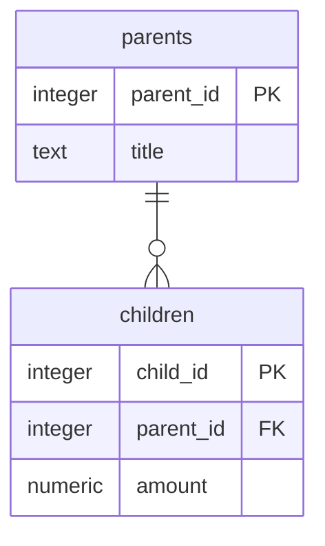

# Лабораторна робота №1. Моделювання предметної області та створення схеми бази даних

Виконавець: Колеснікова Катерина, СТСА-25-1

Предметна область: назва.

<!--
Шаблон звіту. Скопіювати як lab-01/README.md і заповнити всі розділи.
Вимоги до кожного розділу - у методичних вказівках до роботи №1.
Коментарі-підказки на кшталт цього перед здачею можна видалити.
-->

## 1. Предметна область

<!-- 3-5 речень: що це за бізнес, які події відбуваються в часі, які рішення в ньому ухвалюють. -->
Магазин пряжі та товарів для в’язання — роздрібний та онлайн-бізнес, що займається закупівлею пряжі різних виробників і складів, обліком залишків (за партіями фарбування та кольорами) і продажем товарів клієнтам

Події в часі: надходження нових поставок пряжі від постачальників,
 реєстрація нових клієнтів,
 оформлення замовлень,
 списання мотків зі складу під час продажу,
 зміна статусів замовлень

Рішення, що ухвалюються: контроль залишків конкретної партії кольору (щоб клієнт міг докупити пряжу одного відтінку),
 формування закупівель у постачальників,
 аналіз популярності брендів і складів пряжі

## 2. Бізнес-правила

<!-- Не менше восьми правил; схемою перевіряється щонайменше пʼять. -->

| № | Правило | Де перевіряється | Обмеження або обґрунтування |
|---|---|---|---|
| 1 | Якщо створюється категорія товарів, то її назва має бути заповнена й унікальною | схема | `NOT NULL`, `UNIQUE` на стовпці `category_name` |
| 2 | Якщо додається товар (артикул пряжі), то його ціна за моток і вага мотка (у грамах) повинні бути більшими за нуль | схема | `CHECK (price > 0), CHECK (weight_grams > 0)` |
| 3 | Якщо додається позиція в замовлення, то кількість замовлених мотків повинна бути цілим числом, більшим за нуль | схема | `CHECK (quantity > 0)` |
| 4 | Якщо замовлення містить оформлені позиції або за клієнтом закріплені замовлення, то видалити такого клієнта чи товар із бази неможливо (для збереження фінансової історії | схема | `REFERENCES ... ON DELETE RESTRICT` |
| 5 | Якщо видаляється замовлення, то всі його рядки (позиції замовлення) повинні видалятися автоматично разом із ним | схема | `REFERENCES ... ON DELETE CASCADE` |
| 6 | Якщо у клієнта не вказано електронну пошту, запис усе одно дозволяється, але якщо пошта вказана — вона не може повторюватися в інших клієнтів | схема | `UNIQUE` (без `NOT NULL`) на стовпці `email` |
| 7 | Якщо клієнт оформлює замовлення, то система перевіряє, чи вистачає мотків обраної партії фарбування на складі, і зменшує залишок | програма | Логіка бізнес-транзакції (перевірка залишків при оформленні виконується на рівні застосунку) |
| 7 | Якщо сума замовлення клієнта перевищує 3000 грн, то йому автоматично надається персональна знижка 5% на наступні покупки | програма | Динамічний розрахунок знижок і маркетингових акцій реалізується в коді застосунку |

## 3. ER-модель

<!--
Концептуальна модель: назви українською, загальні типи (текст, число, дата, дата_час, логічне). Ідентифікатор - PK.
Кардинальність: || рівно один, |o нуль або один, }| один або багато, }o нуль або багато
(з правого боку звʼязку - дзеркально: ||, o|, |{, o{).
-->

erDiagram
    Категорія ||--o{ Пряжа : "містить"
    Бренд ||--o{ Пряжа : "виробляє"
    Пряжа ||--o{ Позиція_замовлення : "входить_до"
    Замовлення ||--|{ Позиція_замовлення : "складається_з"
    Клієнт ||--o{ Замовлення : "оформлює"
    Постачальник ||--o{ Поставка : "здійснює"
    Поставка ||--o{ Пряжа : "поповнює"

    Категорія {
        число код_категорії PK
        текст назва_категорії
    }
    Бренд {
        число код_бренду PK
        текст назва_бренду
        текст країна
    }
    Постачальник {
        число код_постачальника PK
        текст назва_компанії
        текст телефон
    }
    Поставка {
        число номер_поставки PK
        дата дата_поставки
        текст номер_накладної
    }
    Пряжа {
        текст артикул PK
        текст назва
        текст склад
        текст номер_кольору
        текст партія_фарбування
        число вага_грамів
        число довжина_метрів
        число ціна
        число залишок_мотків
    }
    Клієнт {
        число код_клієнта PK
        текст піб
        текст телефон
        текст пошта
    }
    Замовлення {
        число номер_замовлення PK
        дата_час дата_створення
        текст статус
    }
    Позиція_замовлення {
        число номер_замовлення PK
        текст артикул PK
        число кількість
        число ціна_продажу
    }
    erDiagram
    Категорія ||--o{ Пряжа : "містить"
    Бренд ||--o{ Пряжа : "виробляє"
    Пряжа ||--o{ Позиція_замовлення : "входить_до"
    Замовлення ||--|{ Позиція_замовлення : "складається_з"
    Клієнт ||--o{ Замовлення : "оформлює"
    Постачальник ||--o{ Поставка : "здійснює"
    Поставка ||--o{ Пряжа : "поповнює"

    Категорія {
        число код_категорії PK
        текст назва_категорії
    }
    Бренд {
        число код_бренду PK
        текст назва_бренду
        текст країна
    }
    Постачальник {
        число код_постачальника PK
        текст назва_компанії
        текст телефон
    }
    Поставка {
        число номер_поставки PK
        дата дата_поставки
        текст номер_накладної
    }
    Пряжа {
        текст артикул PK
        текст назва
        текст склад
        текст номер_кольору
        текст партія_фарбування
        число вага_грамів
        число довжина_метрів
        число ціна
        число залишок_мотків
    }
    Клієнт {
        число код_клієнта PK
        текст піб
        текст телефон
        текст пошта
    }
    Замовлення {
        число номер_замовлення PK
        дата_час дата_створення
        текст статус
    }
    Позиція_замовлення {
        число номер_замовлення PK
        текст артикул PK
        число кількість
        число ціна_продажу
    }

### Сутності

- **Категорія** - класифікатор типів пряжі (вовна, бавовна, акрил, змішана)

- **Бренд** - торгова марка виробника пряжі та країна виробництва

- **Пряжа** - конкретна товарна позиція (артикул) із зазначенням складу, кольору, партії фарбування та ціни

- **Клієнт** - покупець магазину пряжі, який реєструється для оформлення замовлень

- **Замовлення** - факт покупки товарів клієнтом у певний момент часу

- **Позиція_замовлення** - асоціативна сутність, що фіксує конкретний артикул пряжі, кількість мотків і зафіксовану ціну в межах замовлення

### Звʼязки

**-** Одна Категорія містить нуль або багато позицій Пряжі; кожна позиція Пряжі належить рівно одній Категорії
**-** Один Бренд виробляє нуль або багато позицій Пряжі; кожна позиція Пряжі належить рівно одному Бренду
**-** Один Клієнт оформлює нуль або багато Замовлень; кожне Замовлення належить рівно одному Клієнту
**-** Одне Замовлення складається з однієї або багатьох Позицій_замовлення; кожна Позиція_замовлення належить рівно одному Замовленню
**-** Одна позиція Пряжі входить до нуля або багатьох Позицій_замовлення; кожна Позиція_замовлення посилається рівно на одну позицію Пряжі

<!-- Узагальнення (EER), якщо воно є: загальна сутність, підтипи та їхні власні атрибути. -->

### Перевірка за типовими помилками

- [ ] Атрибут, який є сутністю: бренд і категорія винесені в окремі сутності, а не записані текстом у пряжі
- [ ] Зв'язок без кардинальності: для кожного зв'язку вказано кардинальність і обов'язковість у нотації Crow's foot
- [ ] Одна таблиця замість кількох: дані клієнтів, замовлень і товарів розділені за змістом
- [ ] Телефон або пошта як PK: для клієнтів використано сурогатний ключ код_клієнта, оскільки телефон чи пошта можуть змінитися

Результат перевірки: що знайдено і як виправлено.

## 4. Ключі та реакції на видалення

### Первинні ключі

| Сутність | Потенційні ключі | Первинний ключ | Обґрунтування |
|---|---|---|---|
| Сутність_1 | ... | ... | природний чи сурогатний і чому |

### Реакції на видалення

| Звʼязок | Реакція | Обґрунтування з погляду бізнесу |
|---|---|---|
| Сутність_1 - Сутність_2 | RESTRICT / CASCADE / SET NULL | що станеться з повʼязаними даними |

## 5. Нормалізація

### Функціональні залежності

1. X → Y

### «Погана» таблиця

<!-- Одна широка таблиця, щонайменше десять стовпців, 3-5 рядків прикладу. -->

| Стовпець 1 | Стовпець 2 | ... |
|---|---|---|
| ... | ... | ... |

### Аномалії

- Аномалія оновлення: конкретна дія і що піде не так.
- Аномалія вставки: конкретна дія і що піде не так.
- Аномалія видалення: конкретна дія і що піде не так.

### Крок 1. 1NF

Отримані таблиці з ключами: ...

Знята проблема: ...

### Крок 2. 2NF

Отримані таблиці з ключами: ...

Знята проблема: ...

### Крок 3. 3NF

Отримані таблиці з ключами: ...

Знята проблема: ...

### Звірка з ER-моделлю

Чи збігаються таблиці після 3NF із сутностями розділу 3; пояснення розбіжностей.

### Денормалізація

<!-- Що дублюється, навіщо і хто підтримує узгодженість. Якщо свідомої денормалізації немає, так і записати. -->

## 6. Реляційна схема

<!--
Назви таблиць і стовпців - точно як у SQL: англійською, малими літерами, через підкреслення; таблиці в множині.
Типи PostgreSQL без параметрів (numeric, а не numeric(8, 2)). Ключі: PK, FK, «PK, FK».
-->



## 7. Середовище

Операційна система: Windows / macOS / Linux.

```bash
docker compose up -d
docker compose ps
```

```text
вивід docker compose ps
```

Підключення pgAdmin: сервер localhost, порт 5432, база dbsa, користувач student.

Перевірка тому: команди `docker compose down` і `docker compose up -d`, стан таблиць після перезапуску.

## 8. Створення схеми

- Міграція 001: [migrations/001_create_schema.up.sql](migrations/001_create_schema.up.sql), [migrations/001_create_schema.down.sql](migrations/001_create_schema.down.sql)
- Рішення, яких не видно з діаграми: умови CHECK, реакції на видалення, стовпці ідентичності.

## 9. Перевірка обмежень

Файл перевірок: [constraint-checks.sql](constraint-checks.sql)

| № | Правило | Обмеження | Повідомлення СУБД |
|---|---|---|---|
| 1 | ... | NOT NULL | `ERROR: null value in column ...` |
| 2 | ... | UNIQUE | `ERROR: duplicate key value violates unique constraint ...` |
| 3 | ... | CHECK | `ERROR: new row for relation ... violates check constraint ...` |
| 4 | ... | REFERENCES | `ERROR: insert or update on table ... violates foreign key constraint ...` |
| 5 | ... | PRIMARY KEY | `ERROR: duplicate key value violates unique constraint ..._pkey` |

## 10. Цикл up - down - up

Результат скрипта перевірки схеми в базі dbsa_check після виконання файлів up:

```text
вставити результат разом із заголовками стовпців
```

Після виконання файлів down: результат порожній / що лишилося.

Після повторного виконання файлів up: результат збігається з першим / чим відрізняється.

Висновок звірки з діаграмою розділу 6: ...
