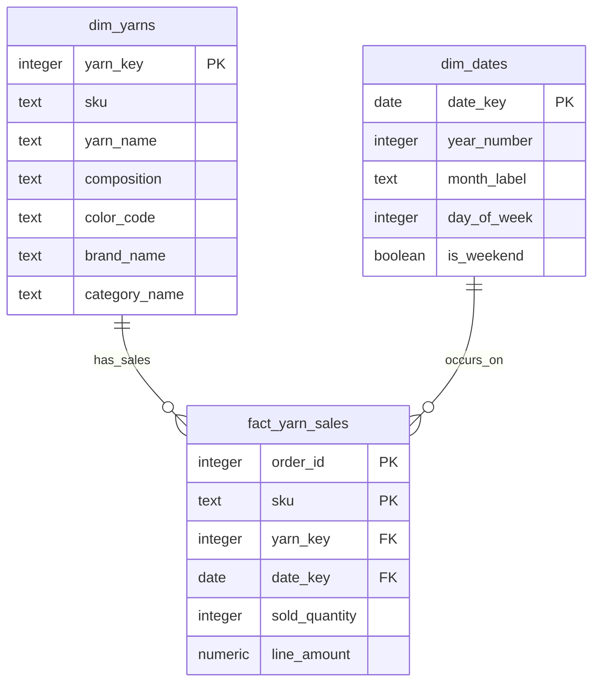

# Лабораторна робота №3. Аналітичні запити та звітність

Виконавець: Колеснікова Катерина, СТСА-25-1

Предметна область: Магазин пряжі та товарів для в’язання


<!--
Шаблон звіту. Скопіювати як lab-03/README.md і заповнити всі розділи.
Вимоги до кожного розділу - у методичних вказівках до роботи №3.
Коментарі-підказки на кшталт цього перед здачею можна видалити.
-->

## 1. Запити на показники

Файл: [analytic-queries.sql](analytic-queries.sql)

<!-- Разом: GROUP BY щонайменше двічі (один раз - WHERE разом з HAVING), CASE усередині агрегатної функції, підзапит у WHERE, підзапит у FROM. -->

| № | Питання замовника | Використані конструкції | Результат |
|---|---|---|---|
| 1 | Яка загальна виручка за завершеними та оплаченими замовленнями (статуси 'completed' або 'paid')? | ... | ... |
| 2 | Які категорії пряжі у вересні 2026 року мали суму продажів понад 600.00 грн (WHERE + GROUP BY + HAVING)? | ... | ... |
| 3 | Скільки всього позицій замовлень і скільки з них належать до замовлень у статусі 'completed' (CASE усередині агрегатної функції)? | ... | ... |
| 4 | Яка середня сума одного замовлення за даними підзапиту у FROM? | ... | ... |
| 5 | Яка кількість мотків продана за кожним статусом замовлення? | ... | ... |
| 6 | Скільки поставок здійснив кожен постачальник, разом із постачальниками без поставок? | LEFT JOIN, GROUP BY, count(стовпця) | ... |

Якщо перенести умову з `HAVING` у `WHERE`, запит поверне помилку агрегації в WHERE, оскільки WHERE фільтрує окремі рядки до групування `(GROUP BY)`, а `HAVING` — вже сформовані групи після нього.

У Запиті 6 `count(*)` після `LEFT JOIN` для рядка без збігів порахував би сам рядок з'єднання з `NULL` праворуч і дав би 1, тоді як `count(sh.shipment_id)` рахує лише не-`NULL` значення стовпця правої таблиці та повертає 0.

## 2. Віконні функції

Файл: [window-queries.sql](window-queries.sql)

### Запит 1. (ранжування з нічиєю). Рейтинг артикулів пряжі за загальною кількістю проданих мотків

```sql
SELECT
    y.sku,
    y.yarn_name,
    sum(oi.quantity) AS total_sold_skeins,
    rank() OVER (ORDER BY sum(oi.quantity) DESC, y.sku ASC) AS rank_pos,
    dense_rank() OVER (ORDER BY sum(oi.quantity) DESC, y.sku ASC) AS dense_rank_pos,
    row_number() OVER (ORDER BY sum(oi.quantity) DESC, y.sku ASC) AS row_num_pos
FROM yarns AS y
JOIN order_items AS oi ON oi.sku = y.sku
GROUP BY y.sku, y.yarn_name
ORDER BY rank_pos, y.sku;
```

Результат: 
YR-002	Jeans	18	1	1	1
YR-004	Baby Wool	10	2	2	2
YR-003	Lima	8	3	3	3
YR-001	Lanagold 800	6	4	4	4

### Запит 2. (накопичувальний підсумок за днями). Накопичувальна сума продажів по днях

```sql
SELECT
    d.order_day,
    d.daily_revenue,
    sum(d.daily_revenue) OVER (ORDER BY d.order_day) AS running_revenue
FROM (
    SELECT
        CAST(o.created_at AS date) AS order_day,
        sum(oi.quantity * oi.unit_price) AS daily_revenue
    FROM orders AS o
    JOIN order_items AS oi ON oi.order_id = o.order_id
    GROUP BY CAST(o.created_at AS date)
) AS d
ORDER BY d.order_day;
```

Результат: 2026-09-15	1265.00	1265.00
2026-09-30	1275.00	2540.00
2026-10-03	1290.00	3830.00
2026-10-12	770.00	4600.00

### Запит 3. (ковзне середнє за 3 рядками). Ковзне середнє кількості проданих мотків за останні 3 дні з продажами
SELECT

```sql
SELECT
    d.order_day,
    d.daily_skeins,
    round(
        avg(d.daily_skeins) OVER (
            ORDER BY d.order_day
            ROWS BETWEEN 2 PRECEDING AND CURRENT ROW
        ),
        2
    ) AS moving_avg_skeins
FROM (
    SELECT
        CAST(o.created_at AS date) AS order_day,
        sum(oi.quantity) AS daily_skeins
    FROM orders AS o
    JOIN order_items AS oi ON oi.order_id = o.order_id
    GROUP BY CAST(o.created_at AS date)
) AS d
ORDER BY d.order_day;
```

| Рядок | Значення | Дні, що ввійшли в рамку |
|---|---|---|
| 1 | 13 | 2026-09-15 |
| 2 | 11 | 2026-09-15, 2026-10-30 |
| 3 | 10,67 | 2026-09-15, 2026-10-30, 2026-10-03 |
| 4 | 9,67 | 2026-09-15, 2026-10-30, 2026-10-03, 2026-10-12 |

### Вікно проти групування

Віконні функції не згортають рядки на відміну від `GROUP BY` — кожен рядок залишається окремим записом із додатковим розрахунком у вікні.

Рамка `ROWS BETWEEN 2 PRECEDING AND CURRENT ROW` бере поточний рядок і до двох попередніх рядків у відсортованому вікні (тобто дні з продажами, а не обов'язково календарні дні підряд, якщо між ними були дні без замовлень)

## 3. Дослід з індексом

Файл генерації: [generate-data.sql](generate-data.sql)

База заміру: `dbsa_big`. Рядків у таблиці подій після генерації: EXPLAIN ANALYZE
SELECT * FROM orders WHERE customer_id = 42;

Запит заміру:

```sql
EXPLAIN ANALYZE
SELECT order_id, created_at, status
FROM orders
WHERE customer_id = 500;
```

| Показник | До індексу | Після індексу |
|---|---|---|
| рядок плану | `Seq Scan on ...` | `... Index Scan ... on ..._idx` |
| рядків таблиці перевірено | `Rows Removed by Filter: ...` | ... |
| `Execution Time`, мс (типове з трьох запусків) | ... | ... |

Міграція індексу: [migrations/003_....up.sql](migrations/003_....up.sql), [migrations/003_....down.sql](migrations/003_....down.sql). Цикл up - down - up: ...

Ціна індексу: розмір таблиці ... , розмір індексу ... (скрипт [table-size.sql](table-size.sql)); друга складова ціни: ...

Умова з <>: SELECT * FROM orders WHERE customer_id <> 500; (відбирає майже всю таблицю, тому послідовне сканування вигідніше).

Пошук за текстом із початковим % (наприклад, за артикулом/назвою): SELECT * FROM yarns WHERE yarn_name LIKE '%Wool'; (B-tree індекс не працює з провідним %).

### Запити, яким індекс не допоміг

| Запит | Очікування | План | Чому |
|---|---|---|---|
| `... LIKE '%...'` | | | |
| `... <> ...` | | | |

## 4. Два навантаження

| Запит | План | `Execution Time`, мс |
|---|---|---|
| пошук за зовнішнім ключем (крок 3) | | |
| аналітичний звіт за днями і розрізом | | |

Чому індекс прискорив один запит і не прискорив другий: ...

### Робоча база і сховище

| Питання | Тип питання | Скільки рядків читає запит | Як часто виконується | Якщо дані застаріли на годину |
|---|---|---|---|---|
| ... | про «зараз» | | | |
| ... | про «зараз» | | | |
| ... | за період | | | |
| ... | за період | | | |

Частота завантаження сховища: ... Обґрунтування: ...

## 5. Схема «зірка»

Зерно таблиці фактів (одним реченням): один рядок - це ...

| Показник | Чому його осмислено додавати або усереднювати |
|---|---|
| ... | ... |
| ... | ... |

| Вимір | Ключ | Чому такий ключ | Описові стовпці |
|---|---|---|---|
| `dim_...` | сурогатний / природний | ... | ... |
| `dim_dates` | природний (сама дата) | ... | ... |

Стовпці таблиці подій, які не стали ні показником, ні атрибутом виміру: ...



Денормалізація виміру: який стовпець повторюється, чому це не загрожує аномаліями оновлення і чим відрізняється від робочої бази: ...

## 6. Міграція зірки

Файли: [migrations/004_....up.sql](migrations/004_....up.sql), [migrations/004_....down.sql](migrations/004_....down.sql)

Результат скрипта перевірки схеми для таблиць сховища:

```text
вставити рядки результату для dim_... , dim_dates і fact_...
```

Цикл up - down - up: після up ... , після down ... , після повторного up ...

## 7. Завантаження

Файл: [load-star.sql](load-star.sql)

Порядок команд і чому саме такий: ...

| Таблиця / показник | До першого запуску | Після першого | Після другого |
|---|---|---|---|
| `dim_...`, рядків | 0 | | |
| `dim_dates`, рядків | 0 | | |
| `fact_...`, рядків | 0 | | |
| сума головного показника | 0 | | |

Повідомлення СУБД після першого і після другого запуску: ...

Дослід з оновленням рядка: що змінено в робочій таблиці, скільки рядків у факті після третього запуску, яке значення стало новим: ...

## 8. Брудні дані

Файли: [stage-source.sql](stage-source.sql), [stage-load.sql](stage-load.sql); міграція [migrations/005_....up.sql](migrations/005_....up.sql), [migrations/005_....down.sql](migrations/005_....down.sql)

| Рядок файлу | Проблема | Відбраковано до / після перетворення типів | Обмеження робочої схеми, яке не пустило б рядок |
|---|---|---|---|
| ... | пропуск обовʼязкового значення | до | NOT NULL ... |
| ... | повний дублікат | після (DISTINCT) | первинний ключ ... |
| ... | значення не того типу чи формату | до | тип стовпця ... |
| ... | суперечність між стовпцями | після | CHECK ... |

Рядків у файлі: 7  Відбраковано: 3  Прибрав DISTINCT: 1  Відсіяла перевірка суперечностей: 1 Додано до таблиці фактів: 3

Як у вимір потрапило значення розрізу нового джерела: ...

Повторний запуск `stage-load.sql`: рядків у таблиці фактів до і після: ...

## 9. Показники і дашборд

Файл: [dashboard-queries.sql](dashboard-queries.sql)

| Елемент дашборду | Показник і розріз | Результат запиту |
|---|---|---|
| картка | ... | ... |
| стовпчикова діаграма | ... | ... |
| часовий ряд | ... | ... |


Дані вивантажено в CSV на момент: ... Частота завантаження сховища: ...

Чому перелік груп у запиті показника 2 бере на себе вимір, а в запиті 6 розділу 1 його довелося здобувати лівим зʼєднанням: ...

Чому дашборд побудовано на вивантаженні CSV, а не прямим підключенням до бази: ...

## 10. Повний прогін у порожній базі

| Дія в базі dbsa_check | Результат |
|---|---|
| файли `*.up.sql` робіт №1-3 за зростанням номерів і скрипт перевірки схеми | без помилок / помилка |
| файли `*.down.sql` роботи №3 за спаданням номерів і скрипт перевірки схеми | таблиць сховища і проміжного шару немає / інше |
| повторний up і скрипт перевірки схеми | результат збігається з першим / відрізняється |
| `seed-data.sql` роботи №2, `load-star.sql` і скрипт підрахунку рядків | збігається з розділом 7 / відрізняється |
| другий запуск `load-star.sql` і скрипт підрахунку рядків | той самий результат / відрізняється |
| запити `analytic-queries.sql`, `window-queries.sql`, `dashboard-queries.sql` | результати збігаються зі звітом / відрізняються |

Виправлені розбіжності, якщо вони були: ...
