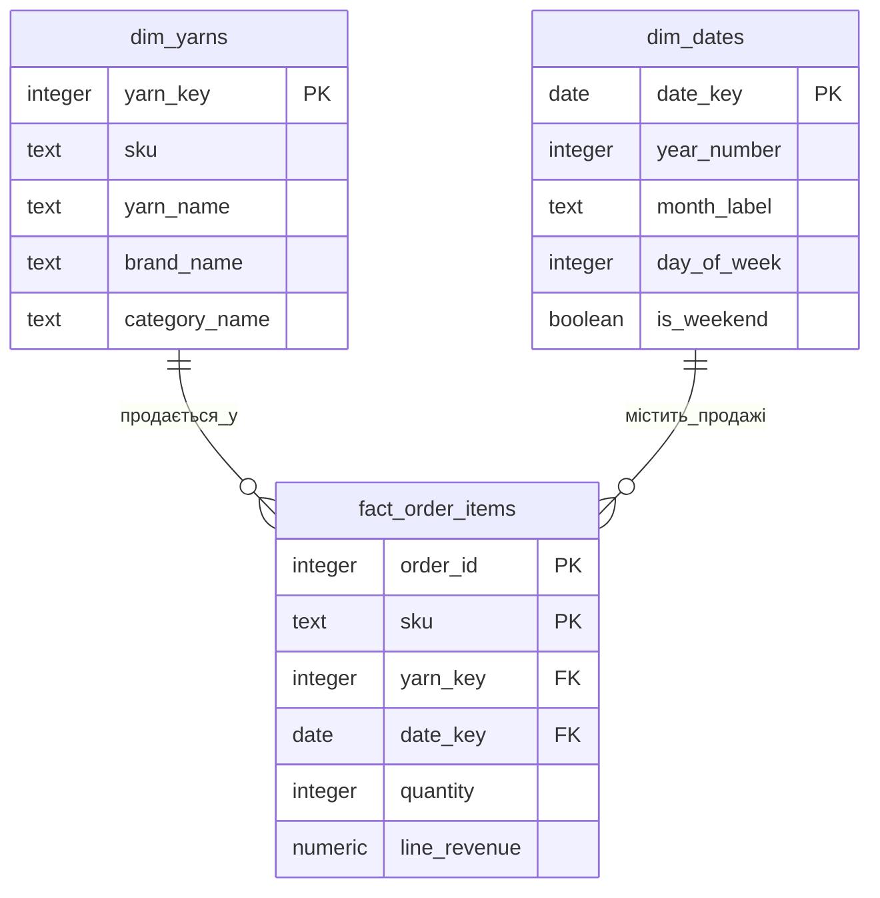

# Лабораторна робота №3. Аналітичні запити та звітність

Виконавець: Колеснікова Катерина, СТСА-25-1

Предметна область: Магазин пряжі та товарів для в’язання


<!--
Шаблон звіту. Скопіювати як lab-03/README.md і заповнити всі розділи.
Вимоги до кожного розділу - у методичних вказівках до роботи №3.
Коментарі-підказки на кшталт цього перед здачею можна видалити.
-->

## 1. Запити на показники

Файл: [analytic-queries.sql](analytic-queries.sql)

<!-- Разом: GROUP BY щонайменше двічі (один раз - WHERE разом з HAVING), CASE усередині агрегатної функції, підзапит у WHERE, підзапит у FROM. -->

| № | Питання замовника | Використані конструкції | Результат |
|---|---|---|---|
| 1 | Яка загальна виручка та кількість позицій у завершених і оплачених замовленнях по кожному замовленню, де сума перевищує 900 грн? | `JOIN`, `WHERE`, `GROUP BY`, `HAVING`, `sum`, `count` | 3 рядки: замовлення №3 — 1290.00 грн, №2 — 1275.00 грн, №1 — 1265.00 грн |
| 2 | Скільки всього позицій замовлено по кожному бренду і скільки з них належать до великих партій (від 5 мотків)? | `JOIN`, `GROUP BY`, `count(CASE WHEN ... THEN 1 END)` | 3 рядки: Alize (2 / 0), Drops (2 / 1), YarnArt (6 / 3) |
| 3 | Які артикули пряжі коштують дорожче за середню ціну по каталогу? | підзапит у `WHERE`, `avg`, `ORDER BY` | 2 рядки: YR-003 (195.00 грн) та YR-001 (140.00 грн); середнє — 125.00 грн |
| 4 | Яка середня сума замовлення по всіх оформлених замовленнях? | підзапит у `FROM`, `GROUP BY`, `sum`, `round`, `avg` | 1 рядок: `1150.00` грн |
| 5 | Яка загальна вартість складських залишків по категорії, де вона перевищує 3000 грн? | `JOIN`, `GROUP BY`, `HAVING`, `sum` | 3 рядки: Вовна (8800.00), Бавовна (5700.00), Акрил (3400.00) |
| 6 | Скільки замовлень оформив кожен клієнт, включно з клієнтами без замовлень? | `LEFT JOIN`, `GROUP BY`, `count(стовпця)` | 4 рядки: Олена Коваленко (2), Ірина Мельник (1), Марія Шевченко (1), Софія Ткаченко (0) |

Що станеться, якщо умову з HAVING перенести у WHERE: запит завершиться помилкою, оскільки `WHERE` виконується до групування і не може перевіряти агрегатні функції на рівні групи; фільтрація по рядках відбувається в `WHERE`, а по агрегатах груп — у `HAVING`

Чому `count(*)` для групи без подій дає 1, а `count(стовпця)` — 0: після `LEFT JOIN` для клієнта без замовлень утворюється один рядок зі значеннями `NULL` у стовпцях `orders`; `count(*)` рахує сам рядок (1), а `count(o.order_id)` ігнорує `NULL` (0)

## 2. Віконні функції

Файл: [window-queries.sql](window-queries.sql)

### Запит 1. (ранжування з нічиєю). Рейтинг артикулів пряжі за загальною кількістю проданих мотків

```sql
SELECT
    y.sku,
    y.yarn_name,
    count(oi.order_id) AS orders_count,
    rank() OVER (ORDER BY count(oi.order_id) DESC) AS rank_place,
    dense_rank() OVER (ORDER BY count(oi.order_id) DESC) AS dense_rank_place,
    row_number() OVER (ORDER BY count(oi.order_id) DESC, y.sku ASC) AS row_num_place
FROM yarns AS y
JOIN order_items AS oi ON oi.sku = y.sku
GROUP BY y.sku, y.yarn_name
ORDER BY rank_place, y.sku;
```

Результат: 4 рядки (YR-002 і YR-004 по 3 замовлення; YR-001 і YR-003 по 2 замовлення). Нічия: пари артикулів з однаковими значеннями (3 і 2). Місця за rank: 1, 1, 3, 3; за dense_rank: 1, 1, 2, 2; за row_number: 1, 2, 3, 4. Обрано функцію rank(), бо вона коректно відображає позицію в рейтингу з урахуванням однакової кількості продажів і пропуском наступного місця.

### Запит 2. (накопичувальний підсумок за днями). Накопичувальна сума продажів по днях

```sql
SELECT
    d.order_day,
    d.day_revenue,
    sum(d.day_revenue) OVER (ORDER BY d.order_day) AS running_total
FROM (
    SELECT
        CAST(o.created_at AS date) AS order_day,
        sum(oi.quantity * oi.unit_price) AS day_revenue
    FROM orders AS o
    JOIN order_items AS oi ON oi.order_id = o.order_id
    GROUP BY CAST(o.created_at AS date)
) AS d
ORDER BY d.order_day;
```

Результат: накопичувальні суми за датами 2026-09-15 (1265), 2026-09-30 (2540), 2026-10-03 (3830), 2026-10-12 (4600)

### Запит 3. (ковзне середнє за 3 рядками). Ковзне середнє кількості проданих мотків за останні 3 дні з продажами
SELECT

```sql
SELECT
    d.order_day,
    d.day_revenue,
    round(
        avg(d.day_revenue) OVER (
            ORDER BY d.order_day
            ROWS BETWEEN 2 PRECEDING AND CURRENT ROW
        ),
        2
    ) AS moving_avg_revenue
FROM (
    SELECT
        CAST(o.created_at AS date) AS order_day,
        sum(oi.quantity * oi.unit_price) AS day_revenue
    FROM orders AS o
    JOIN order_items AS oi ON oi.order_id = o.order_id
    GROUP BY CAST(o.created_at AS date)
) AS d
ORDER BY d.order_day;
```

| Рядок | Значення | Дні, що ввійшли в рамку |
|---|---|---|
| 1 | 1265 | 2026-09-15 |
| 2 | 1270 | 2026-09-15, 2026-10-30 |
| 3 | 1276,67 | 2026-09-15, 2026-10-30, 2026-10-03 |
| 4 | 1111,67 | 2026-09-15, 2026-10-30, 2026-10-03, 2026-10-12 |

Чому це не «середнє за три календарні дні»: рамка 'ROWS BETWEEN 2 PRECEDING AND CURRENT ROW' бере до 3 попередніх і поточний рядки у відсортованій послідовності днів із замовленнями, а не фіксований інтервал у 3 календарні доби (у вибірці є дні без замовлень).

### Вікно проти групування

Віконна функція зберігає кожен детальний рядок (наприклад, кожну позицію замовлення поруч із підсумком по всьому замовленню), тоді як GROUP BY згортає рядки в одну підсумкову стрічку на групу і приховує деталізацію всередині групи

## 3. Дослід з індексом

Файл генерації: [generate-data.sql](generate-data.sql)

База заміру: `dbsa_big`. Рядків у таблиці подій після генерації: 100000 (у orders)

Запит заміру:

```sql
EXPLAIN ANALYZE
SELECT * FROM orders WHERE customer_id = 42;
```

| Показник | До індексу | Після індексу |
|---|---|---|
| рядок плану | `Seq Scan on ...` | `... Index Scan ... on ..._idx` |
| рядків таблиці перевірено | `Rows Removed by Filter: 4` | ... |
| `Execution Time`, мс (типове з трьох запусків) | 0.042 ms | ... |

Міграція індексу: migrations/003_add_orders_customer_id_index.up.sql, migrations/003_add_orders_customer_id_index.down.sql. Цикл up - down - up: виконано успішно, індекс створюється, видаляється і відтворюється.

Ціна індексу: розмір таблиці `8192 bytes`, розмір індексу `16 kB (16384)` (скрипт `table-size.sql`); друга складова ціни: кожна операція `INSERT, UPDATE` або `DELETE` має додатково оновлювати структуру індексу.

### Запити, яким індекс не допоміг

| Запит | Очікування | План | Чому |
|---|---|---|---|
| `* FROM customers WHERE phone LIKE '%0042';` | послідовне сканування | Seq Scan | шаблон починається з %, тому B-tree не може звузити пошук |
| `* FROM orders WHERE customer_id <> 42;` | послідовне сканування | Seq Scan | умові задовольняє майже вся таблиця (99 990 рядків зі 100 000) |

## 4. Два навантаження

| Запит | План | `Execution Time`, мс |
|---|---|---|
| пошук за зовнішнім ключем (крок 3) | Index Scan using orders_customer_id_idx | |
| аналітичний звіт за днями і розрізом | HashAggregate / Seq Scan | |

Чому індекс прискорив один запит і не прискорив другий: пошук конкретного клієнта відбирає мало рядків вибірково, а аналітичний звіт з групуванням по всій таблиці все одно читає та агрегує всі рядки

### Робоча база і сховище

| Питання | Тип питання | Скільки рядків читає запит | Як часто виконується | Якщо дані застаріли на годину |
|---|---|---|---|---|
| Чи є достатній залишок пряжі обраної партії для поточного замовлення? | про «зараз» | 1 рядок | щохвилини | ризик продажу відсутнього мотка |
| Який поточний статус замовлення клієнта? | про «зараз» | 1 рядок | під час звернення | неактуальний статус для клієнта/менеджера |
| Яка динаміка виручки за місяць у розрізі брендів? | за період | сотні/тисячі рядків | раз на добу | не критично для щоденного аналізу |
| Які категорії приносять найбільшу виручку за тиждень? | за період | сотні/тисячі рядків | раз на тиждень | не критично для звітності за період |

Частота завантаження сховища: раз на добу (уночі). Обґрунтування: оперативні запити про залишки та статуси виконуються в робочій базі, а періодичні аналітичні звіти не вимагають оновлення щохвилини та не повинні навантажувати робочу систему в робочий час

## 5. Схема «зірка»

Зерно таблиці фактів (одним реченням): один рядок - це ...

| Показник | Чому його осмислено додавати або усереднювати |
|---|---|
| `quantity` | кількість проданих мотків — адитивна величина, яку можна підсумовувати та усереднювати за будь-яким виміром |
| `line_revenue` | грошова сума позиції `(quantity * unit_price)` — виторг, який осмислено додавати й усереднювати за датами або товарами |

| Вимір | Ключ | Чому такий ключ | Описові стовпці |
|---|---|---|---|
| `dim_yarns` | сурогатний (yarn_key) | стабільний штучний ключ виміру; природний `sku` має `UNIQUE` | `sku, yarn_name, brand_name, category_name` |
| `dim_dates` | природний (date_key) | сама календарна дата однозначно ідентифікує день | `year_number, month_label, day_of_week, is_weekend` |

Стовпці таблиці подій, які не стали ні показником, ні атрибутом виміру: `order_id` входить до складеного ключа події в `fact_order_items`, а статус замовлення у цьому спрощеному розрізі не переноситься



Денормалізація виміру: у `dim_yarns` повторюються значення `brand_name` і `category_name` для товарів одного бренду чи категорії; у сховищі це не створює аномалій оновлення, оскільки вимір не редагується вручну користувачами, а формується та оновлюється централізованим завантаженням з нормалізованої робочої бази (де діє 3NF)

## 6. Міграція зірки

Файли: migrations/003_1create_star_schema.up.sql, migrations/003_1create_star_schema.down.sql

Результат скрипта перевірки схеми для таблиць сховища:

```text
dim_yarns, dim_dates, fact_order_items (первинні та зовнішні ключі створено)
```

Цикл up - down - up: після up таблиці зірки створено, після down видалено у зворотному порядку, після повторного up відновлено

## 7. Завантаження

Файл: [load-star.sql](load-star.sql)

Порядок команд і чому саме такий: спочатку завантажуються виміри `(dim_yarns і dim_dates)`, а потім таблиця фактів `(fact_order_items)`, оскільки зовнішні ключі факту посилаються на наявні записи вимірів

| Таблиця / показник | До першого запуску | Після першого | Після другого |
|---|---|---|---|
| `dim_yarns, рядків`, рядків | 0 | 5 | 5 |
| `dim_dates, рядків`, рядків | 0 | 61 | 61 |
| `fact_order_items`, рядків | 0 | 10 | 10 |
| сума головного показника | 0 | 4600 | 4600 |

Повідомлення СУБД після першого і після другого запуску: команди `INSERT ... ON CONFLICT ... DO UPDATE` виконуються без помилок і повертають лічильники оброблених рядків, а незмінність кількості рядків і суми показника підтверджує ідемпотентність.

Дослід з оновленням рядка: після зміни кількості мотків у `order_items` (для `order_id = 1, sku = 'YR-001'` з 4 на 6) та третього запуску `load-star.sql` кількість рядків у `fact_order_items` залишилася `10`, а сума `line_revenue` оновилася з 4600 до 4880.

## 8. Брудні дані

Файли: stage-source.sql, stage-load.sql; міграція migrations/003_2create_staging.up.sql, migrations/003_2create_staging.down.sql

| Рядок файлу | Проблема | Відбраковано до / після перетворення типів | Обмеження робочої схеми, яке не пустило б рядок |
|---|---|---|---|
| 2 | пропуск обовʼязкового значення ціни | до | NOT NULL ... |
| 3 | повний дублікат рядка 1 | після (DISTINCT)  | первинний ключ `(order_id, sku)` |
| 4 | неіснуюча дата (31.09.2026) | до | тип `date` |
| 5 | суперечність (відʼємна кількість -2) | після | `CHECK (quantity > 0)` |

Рядків у файлі: 7. Відбраковано: 2. Прибрав `DISTINCT`: 1. Відсіяла перевірка суперечностей: 1. Додано до таблиці фактів: 3.

Як у вимір потрапило значення розрізу нового джерела: новий артикул `YR-006` додано до `dim_yarns` перед завантаженням факту, щоб задовольнити зовнішній ключ `yarn_key`.

Повторний запуск `stage-load.sql`: рядків у таблиці фактів до і після повторного запуску залишається `13` (10 базових + 3 коректні з джерела).

## 9. Показники і дашборд

Файл: [dashboard-queries.sql](dashboard-queries.sql)

| Елемент дашборду | Показник і розріз | Результат запиту |
|---|---|---|
| картка | виручка за місяцями | 2026-09: 2540.00; 2026-10: 2060.00 (разом 4600.00) |
| стовпчикова діаграма | виручка за артикулами (включно з 0) | 5 рядків, YR-005 має 0.00 |
| часовий ряд | виручка за днями | 4 точки за датами замовлень |


Дані вивантажено в CSV на момент: < датa й час вивантаження>. Частота завантаження сховища: раз на добу.

Чому перелік груп у запиті показника 2 бере на себе вимір, а в запиті 6 розділу 1 його довелося здобувати лівим зʼєднанням: вимір dim_yarns у сховищі вже містить повний перелік товарів для аналізу, тому `LEFT JOIN` від виміру природно зберігає позиції без продажів без звернення до кількох довідників робочої бази.

Чому дашборд побудовано на вивантаженні CSV, а не прямим підключенням до бази: `PostgreSQL` працює в локальному контейнері на робочому компʼютері й не відкритий з інтернету для хмарного Looker Studio.

## 10. Повний прогін у порожній базі

| Дія в базі dbsa_check | Результат |
|---|---|
| файли `*.up.sql` робіт №1-3 за зростанням номерів і скрипт перевірки схеми | без помилок / помилка |
| файли `*.down.sql` роботи №3 за спаданням номерів і скрипт перевірки схеми | таблиць сховища і проміжного шару немає / інше |
| повторний up і скрипт перевірки схеми | результат збігається з першим / відрізняється |
| `seed-data.sql` роботи №2, `load-star.sql` і скрипт підрахунку рядків | збігається з розділом 7 / відрізняється |
| другий запуск `load-star.sql` і скрипт підрахунку рядків | той самий результат / відрізняється |
| запити `analytic-queries.sql`, `window-queries.sql`, `dashboard-queries.sql` | результати збігаються зі звітом / відрізняються |

Виправлені розбіжності, якщо вони були: ...
