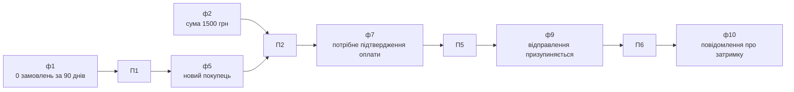
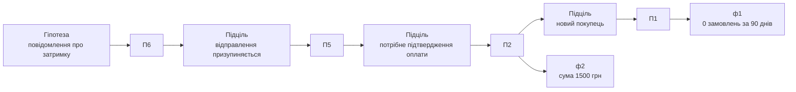
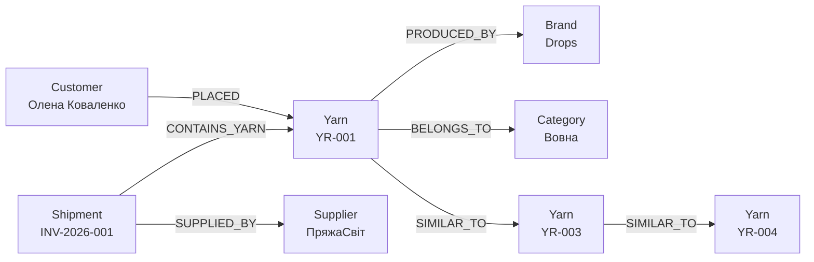

# Лабораторна робота №5. Організація знань предметної області

Виконавець: Колеснікова Катерина, СТСА-25-1

Предметна область: Магазин пряжі та товарів для в’язання

<!--
Шаблон звіту. Скопіювати як lab-05/README.md і заповнити всі розділи.
Вимоги до кожного розділу - у методичних вказівках до роботи №5.
Розділ 10 заповнюється, лише якщо виконано задачу із зірочкою.
Коментарі-підказки на кшталт цього перед здачею можна видалити.
-->

## 1. База правил

Файл: [rules.md](rules.md)

| № | ЯКЩО умова | ТО висновок |
|---|---|---|
| П1 | клієнт має 0 оплачених або завершених замовлень за останні 90 днів | клієнт є новим покупцем |
| П2 | клієнт є новим покупцем і сума поточного замовлення перевищує 1200 грн | потрібне підтвердження оплати до відправлення |
| П3 | залишок на складі для артикулу пряжі менший за 5 мотків | артикул має низький складський залишок |
| П4 | артикул має низький складський залишок і замовлена кількість становить 5 або більше мотків | потрібне узгодження списання зі складом |
| П5 | потрібне підтвердження оплати до відправлення або потрібне узгодження списання зі складом | відправлення замовлення призупиняється |
| П6 | відправлення замовлення призупиняється | клієнту надсилається повідомлення про затримку відправлення |
| П7 | залишок на складі для артикулу пряжі становить 20 або більше мотків | складський запас артикулу достатній |
| П8 | складський запас артикулу достатній | резервування замовлення дозволено |

Правила, що спираються на висновки інших правил: П2, П4, П5, П6, П8 (номери)[cite: 36].

Правило зі складеною умовою: П2 (також П4). Дві частини умови: «клієнт є новим покупцем» і «сума поточного замовлення перевищує 1200 грн»[cite: 36].

Пара правил із протилежними висновками: П5 («відправлення замовлення призупиняється») і П8 («резервування замовлення дозволено»). Величина, за якою розведено їхні умови: складський залишок артикулу пряжі (`stock_quantity` у мотках). Значення, на якому проходить межа: `< 5` мотків для низького залишку (П3 -> П4 -> П5) та `>= 20` мотків для достатнього запасу (П7 -> П8)[cite: 36].

## 2. Джерело кожної умови

| Правило | Умова | Джерело (таблиця і стовпець / висновок правила / людина) |
|---|---|---|
| П1 | клієнт має 0 оплачених або завершених замовлень за останні 90 днів | `orders.customer_id`, `orders.status`, `orders.created_at` |
| П2 (частина 1) | клієнт є новим покупцем | висновок правила П1 |
| П2 (частина 2) | сума поточного замовлення перевищує 1200 грн | `order_items.quantity`, `order_items.unit_price` |
| П3 | залишок на складі для артикулу пряжі менший за 5 мотків | `yarns.stock_quantity` |
| П4 (частина 1) | артикул має низький складський залишок | висновок правила П3 |
| П4 (частина 2) | замовлена кількість становить 5 або більше мотків | `order_items.quantity` |
| П5 | потрібне підтвердження оплати до відправлення або потрібне узгодження списання зі складом | висновки правил П2 / П4 |
| П6 | відправлення замовлення призупиняється | висновок правила П5 |
| П7 | залишок на складі для артикулу пряжі становить 20 або більше мотків | `yarns.stock_quantity` |
| П8 | складський запас артикулу достатній | висновок правила П7 |

Правил, що спираються лише на початкові факти: 3 (П1, П3, П7). Правил, що спираються на висновки інших: 5 (П2, П4, П5, П6, П8)[cite: 36].

Умова, для якої даних у схемі роботи №1 немає: наявність та ступінь сумісності/схожості між артикулами пряжі для підбору заміни (`SIMILAR_TO`). Що довелося б додати до схеми: окрему таблицю звʼязку між артикулами (наприклад, `yarn_substitutions(sku, similar_sku, reason)`)[cite: 36, 38].

## 3. Два прогони прямого виведення

### Прогін 1

Початкові факти:

| № | Факт |
|---|---|
| ф1 | клієнт має 0 оплачених або завершених замовлень за останні 90 днів |
| ф2 | сума поточного замовлення становить 1500 грн |
| ф3 | залишок на складі для артикулу становить 3 мотки |
| ф4 | замовлена кількість становить 6 мотків |

Конфліктний набір першого циклу: П1, П3. Порядок застосування: за номером правила[cite: 36].

| Цикл | Правило | Новий факт |
|---|---|---|
| 1 | П1 | ф5: клієнт є новим покупцем |
| 1 | П3 | ф6: артикул має низький складський залишок |
| 2 | П2 | ф7: потрібне підтвердження оплати до відправлення |
| 2 | П4 | ф8: потрібне узгодження списання зі складом |
| 3 | П5 | ф9: відправлення замовлення призупиняється |
| 4 | П6 | ф10: клієнту надсилається повідомлення про затримку відправлення |
| 5 | - | - |

Фактів на початку: 4. Фактів наприкінці: 10[cite: 36].

Правила, що не спрацювали жодного разу: П7, П8. Чому це не помилка бази правил: база правил описує різні типові ситуації предметної області (зокрема достатній запас), а конкретний прогін перевіряє одну ситуацію з низьким залишком; тривожною була б ситуація, коли жодне правило не спрацьовує на жодній коректній ситуації області[cite: 36, 46].

### Прогін 2

Початкові факти:

| № | Факт |
|---|---|
| ф1 | клієнт має 4 завершених замовлення за останні 90 днів |
| ф2 | сума поточного замовлення становить 600 грн |
| ф3 | залишок на складі для артикулу становить 24 мотки |
| ф4 | замовлена кількість становить 3 мотки |

Конфліктний набір першого циклу: П7[cite: 36].

| Цикл | Правило | Новий факт |
|---|---|---|
| 1 | П7 | ф5: складський запас артикулу достатній |
| 2 | П8 | ф6: резервування замовлення дозволено |
| 3 | - | - |

Фактів на початку: 4. Фактів наприкінці: 6[cite: 36].

Правила, що не спрацювали жодного разу: П1, П2, П3, П4, П5, П6[cite: 36].

Що змінилося порівняно з прогоном 1 і чому правила при цьому не змінювалися: змінилися вхідні факти в робочій памʼяті (постійний клієнт, менша сума замовлення і великий складський залишок), тому спрацювала інша гілка виведення (П7 -> П8) і отримано інший кінцевий висновок без зміни самих правил — це показує, що стабільні бізнес-правила можна зберігати й підтримувати окремо від змінних фактів конкретної події[cite: 28, 36, 46].

## 4. Ланцюжки виведення

### Ланцюжок прогону 1

Висновок: клієнту надсилається повідомлення про затримку відправлення.




### Ланцюжок прогону 2

Висновок: резервування замовлення дозволено.


Спрацювало, але в ланцюжок не ввійшло: нічого — у другому прогоні спрацювали лише правила П7 та П8, і обидва ведуть до обраного висновку  
Пояснення для замовника одним реченням: резервування пряжі дозволено, оскільки на складі є достатній запас артикулу

## 5. Зворотне виведення

### Гіпотеза, яка підтверджується

Гіпотеза: клієнту надсилається повідомлення про затримку відправлення (на фактах прогону 1



Правила, які не знадобилися: П3, П4, П7, П8 (а також гілка П4 для узгодження списання зі складом, оскільки достатньо було підтвердити висновок через П5 -> П2 -> П1).   
Обсяг роботи: прямий прогін перебирав 8 правил у циклах, зворотне виведення перевірило 4 правила вздовж активної гілки виведення.

### Гіпотеза, яка не підтверджується

Гіпотеза: резервування замовлення дозволено (перевіряється на фактах прогону 1, де залишок лише 3 мотки)


Підціль, на якій обривається гілка: перевірка умови залишку >= 20 мотків (немає ні такого факту в робочій памʼяті, ні правила, яке виводило б достатній запас при залишку 3 мотки).   

Відповідь «ні» означає: нічого не відомо про виконання цієї гіпотези в поточній системі фактів і правил (не підтверджено). Домовленість, через яку система відповідає саме так: припущення замкнутого світу (closed-world assumption), за яким усе, що не виводиться з наявних фактів і правил, вважається непідтвердженим/хибним у межах моделі. 

Чим це небезпечно для замовника: відсутність підтвердження гіпотези за наявними фактами може сприйматися як доведена відмова або «все гаразд», навіть якщо вхідний факт просто не передали або не оновили вчасно.   

Як те саме питання поводилося в SQL робіт №2 і 3: у SQL діє тризначна логіка (TRUE, FALSE, UNKNOWN через NULL), де невідоме значення не дорівнює ні істині, ні хибності, а перевірка заперечення з NULL (наприклад, у NOT IN) може не давати очікуваного істинного результату. 

## 6. Граф знань

| Мітка | Що це в області | Властивість-ідентифікатор | Інші властивості |
|---|---|---|---|
| `Customer` | покупець магазину пряжі | `customer_id` | `full_name, phone` |
| `Yarn` | артикул пряжі в каталозі | `sku` | `yarn_name, price, stock_quantity` |
| `Brand` | бренд виробника пряжі | `brand_name` | `country` |
| `Category` | категорія пряжі (вовна, бавовна тощо) | `category_name` | `-` |
| `Shipment` | поставка пряжі від постачальника | `invoice_number` | `shipment_date` |
| `Supplier` | постачальник пряжі | `company_name` | `phone` |

| Тип звʼязку | Від мітки | До мітки | Властивості звʼязку |
|---|---|---|---|
| PLACED | Customer | Yarn | order_id, ordered_at, status, quantity, unit_price |
| PRODUCED_BY | Yarn | Brand | - |
| BELONGS_TO | Yarn | Category | - |
| CONTAINS_YARN | Shipment | Yarn | - |
| SUPPLIED_BY | Shipment | Supplier | - |
| SIMILAR_TO | Yarn | Yarn | reason |

| Схема роботи №1 | Граф знань |
|---|---|
| сутність `yarns, customers, brands, categories, shipments, suppliers` | мітка `Yarn, Customer, Brand, Category, Shipment, Supplier` |
| атрибут `yarn_name, price, stock_quantity, full_name, country` | властивість вершини (`yarn_name, price, stock_quantity, full_name, country`) |
| зовнішній ключ / звʼязок між сутностями | тип звʼязку (`PRODUCED_BY, BELONGS_TO, CONTAINS_YARN, SUPPLIED_BY, PLACED`) |

Фрагмент графа:



Звʼязок, якого не було в реляційній схемі роботи №1: SIMILAR_TO (схожість/можливість заміни одного артикулу пряжі іншим при підборі ниток)
Чому він там не зберігався: у реляційній схемі роботи №1 не було таблиці чи поля для опису сумісності/заміни між артикулами пряжі
Що для нього знадобилося б у PostgreSQL: створити додаткову таблицю звʼязків між двома записами yarns (наприклад, yarn_substitutions) і прописати в ній зовнішні ключі на yarns.sku

## 7. Скрипт створення графа

Файл: [graph.cypher](graph.cypher)

| Запуск | Вершин (`count(n)`) | Звʼязків (`count(r)`) |
|---|---|---|
| після першого | ... | ... |
| після другого | ... | ... |

Висновок числами: після першого запуску граф містить [N] вершин і [R] звʼязків, а після другого запуску кількість вершин залишається [N] і кількість звʼязків — [R]

Який прийом роботи №2 повторює MERGE: ідемпотентне додавання з перевіркою унікальності (як INSERT ... ON CONFLICT DO NOTHING / DO UPDATE), яке не створює дублікат при повторному виконанні 

Яка вимога робіт №2 і №4 тут перевіряється: вимога ідемпотентності повторного запуску скрипта наповнення без задвоєння записів

## 8. Три запити Cypher

Файл: [queries.cypher](queries.cypher)

### Запит 1. Зіставлення зі зразком з умовою

Питання області: Які клієнти та які артикули пряжі мають замовлення у статусі '`new`'?

```cypher
MATCH (c:Customer)-[r:PLACED]->(y:Yarn)
WHERE r.status = 'new'
RETURN c.full_name AS customer, y.sku AS sku, r.quantity AS quantity, r.status AS status;
```

Результат:

```text
...
```

### Запит 2. Шлях змінної довжини

Питання області: Які артикули пряжі доступні як заміна/аналог для YR-001 на відстані 1–2 кроків звʼязку `SIMILAR_TO`?

```cypher
MATCH p = (start:Yarn {sku: 'YR-001'})-[:SIMILAR_TO*1..2]-(candidate:Yarn)
RETURN DISTINCT candidate.sku AS candidate_sku, candidate.yarn_name AS yarn_name, length(p) AS steps
ORDER BY steps, candidate_sku;
```

Результат:

```text
...
```

Скільки зʼєднань знадобилося б для того самого запиту в SQL: для проходження до 2 кроків знадобилося б два самозʼєднання (JOIN) таблиці звʼязків і ще одне приєднання до таблиці артикулів. 
Чому глибину довелося б знати наперед: у класичному реляційному JOIN кількість зʼєднань фіксується в тексті запиту наперед, тоді як у Cypher діапазон довжини шляху задається безпосередньо у шаблоні (*1..2)

### Запит 3. Перевірка умови правила

Умову якого правила перевіряє: П4 (низький складський залишок `< 5` мотків і замовлена кількість `>= 5` мотків)

```cypher
MATCH (c:Customer)-[r:PLACED]->(y:Yarn)
WHERE y.stock_quantity < 5 AND r.quantity >= 5
RETURN c.full_name AS customer, y.sku AS sku, y.stock_quantity AS stock_quantity, r.quantity AS ordered_quantity;
```

Результат:

```text
...
```

Чи досить цього запиту, щоб замінити механізм виведення: ні, запит лише знаходить збіг за умовою в графі, але не запускає послідовне застосування правил, не формує ланцюжок висновків і не знає, які наступні правила (наприклад, П5 та П6) мають спрацювати далі

## 9. Знання проти даних

Чим знання роботи №5 відрізняється від даних робіт №1-4 (походження, межі, підзвітність):

...

Предметний експерт власної області: посада ... , які рішення ухвалює ...

### Запис журналу рішень

Висновок: ...

| Пункт | Зміст |
|---|---|
| Факти на момент рішення | ф1..ф4 (0 завершених замовлень за 90 днів, сума замовлення 1500 грн, залишок 3 мотки, замовлено 6 мотків) |
| Версія бази правил | коміт репозиторію з файлом lab-05/rules.md (наприклад, v1.0 / хеш коміту rules.md) |
| Ланцюжок виведення | ф1 -> П1 -> ф5; ф2 + ф5 -> П2 -> ф7; ф7 -> П5 -> ф9 -> П6 -> ф10 |
| Хто підтверджує рішення | людина (менеджер замовлень / предметний експерт у контурі контролю) |

Що стане неможливим без версії бази правил: без версії бази правил неможливо достовірно відтворити через рік, за якими саме формулюваннями й порогами правил було отримано рішення.   

Яка вимога попередніх робіт тут повторюється: відтворюваність та ідемпотентність — за тих самих вхідних фактів і тієї самої версії бази правил система має стабільно давати той самий результат.

## 10. Задача із зірочкою: механізм прямого виведення

<!-- Розділ заповнюється, лише якщо задачу виконано; інакше його видаляють. -->

Каталог: [inference/](inference/)

Мова програмування: ... Як запустити: ...

Де лежать правила: ... Де лежать початкові факти: ...

Вивід прогону 1:

```text
...
```

Вивід прогону 2:

```text
...
```

| Що звіряємо | Ручний прогін | Програма |
|---|---|---|
| кількість циклів | ... | ... |
| фактів наприкінці | ... | ... |
| правила, що не спрацювали | ... | ... |
| кінцевий висновок | ... | ... |

Розбіжність і в чому вона полягала: ...

## 11. Протокол запуску середовища

```text
docker compose -f compose-neo4j.yaml up -d
docker compose -f compose-neo4j.yaml ps
```

Вивід `docker compose -f compose-neo4j.yaml ps`:

```text
...
```

Перевірка підключення (`RETURN 1 AS ok`): ...

Перевірка порожнього графа (`MATCH (n) RETURN count(n) AS nodes`): ...
