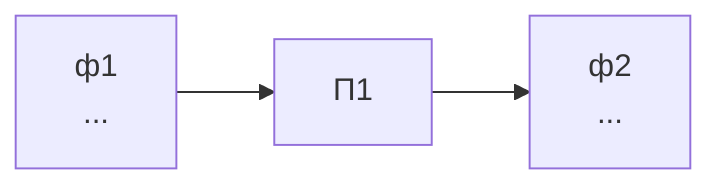
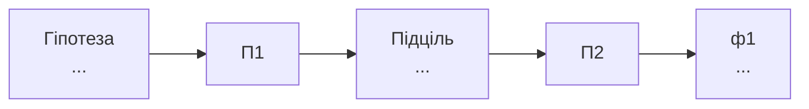
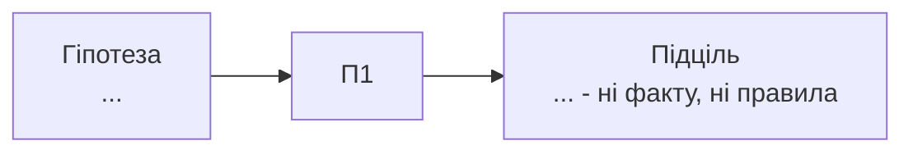
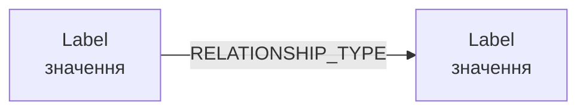

# Лабораторна робота №5. Організація знань предметної області

Виконавець: прізвище та імʼя, група.

Предметна область: назва.

<!--
Шаблон звіту. Скопіювати як lab-05/README.md і заповнити всі розділи.
Вимоги до кожного розділу - у методичних вказівках до роботи №5.
Розділ 10 заповнюється, лише якщо виконано задачу із зірочкою.
Коментарі-підказки на кшталт цього перед здачею можна видалити.
-->

## 1. База правил

Файл: [rules.md](rules.md)

| № | ЯКЩО умова | ТО висновок |
|---|---|---|
| П1 | ... | ... |
| П2 | ... | ... |
| П3 | ... | ... |
| П4 | ... | ... |
| П5 | ... | ... |
| П6 | ... | ... |
| П7 | ... | ... |
| П8 | ... | ... |

Правила, що спираються на висновки інших правил: ... (номери)

Правило зі складеною умовою: ... Дві частини умови: ... і ...

Пара правил із протилежними висновками: ... і ... Величина, за якою розведено їхні умови: ... Значення, на якому проходить межа: ...

## 2. Джерело кожної умови

| Правило | Умова | Джерело (таблиця і стовпець / висновок правила / людина) |
|---|---|---|
| П1 | ... | ... |
| П2 | ... | ... |

Правил, що спираються лише на початкові факти: ... Правил, що спираються на висновки інших: ...

Умова, для якої даних у схемі роботи №1 немає: ... Що довелося б додати до схеми: ...

## 3. Два прогони прямого виведення

### Прогін 1

Початкові факти:

| № | Факт |
|---|---|
| ф1 | ... |
| ф2 | ... |
| ф3 | ... |
| ф4 | ... |
| ф5 | ... |

Конфліктний набір першого циклу: ... Порядок застосування: за номером правила.

| Цикл | Правило | Новий факт |
|---|---|---|
| 1 | ... | ... |
| 2 | ... | ... |
| 3 | ... | ... |
| 4 | - | - |

Фактів на початку: ... Фактів наприкінці: ...

Правила, що не спрацювали жодного разу: ... Чому це не помилка бази правил: ...

### Прогін 2

Початкові факти:

| № | Факт |
|---|---|
| ф1 | ... |
| ф2 | ... |

Конфліктний набір першого циклу: ...

| Цикл | Правило | Новий факт |
|---|---|---|
| 1 | ... | ... |
| 2 | - | - |

Фактів на початку: ... Фактів наприкінці: ...

Правила, що не спрацювали жодного разу: ...

Що змінилося порівняно з прогоном 1 і чому правила при цьому не змінювалися: ...

## 4. Ланцюжки виведення

### Ланцюжок прогону 1

Висновок: ...



Спрацювало, але в ланцюжок не ввійшло: ...

Пояснення для замовника одним реченням: ...

### Ланцюжок прогону 2

Висновок: ...


Спрацювало, але в ланцюжок не ввійшло: ...

Пояснення для замовника одним реченням: ...

## 5. Зворотне виведення

### Гіпотеза, яка підтверджується

Гіпотеза: ...



Правила, які не знадобилися: ...

Обсяг роботи: прямий прогін перебирав ... правил, зворотне виведення перевірило ... .

### Гіпотеза, яка не підтверджується

Гіпотеза: ...



Підціль, на якій обривається гілка: ...

Відповідь «ні» означає ... (відомо, що ні / нічого не відомо). Домовленість, через яку система відповідає саме так: ...

Чим це небезпечно для замовника: ...

Як те саме питання поводилося в SQL робіт №2 і 3: ...

## 6. Граф знань

| Мітка | Що це в області | Властивість-ідентифікатор | Інші властивості |
|---|---|---|---|
| ... | ... | ... | ... |

| Тип звʼязку | Від мітки | До мітки | Властивості звʼязку |
|---|---|---|---|
| ... | ... | ... | ... |

| Схема роботи №1 | Граф знань |
|---|---|
| сутність ... | мітка ... |
| атрибут ... | властивість ... |
| зовнішній ключ ... | тип звʼязку ... |

Фрагмент графа:



Звʼязок, якого не було в реляційній схемі роботи №1: ...

Чому він там не зберігався: ...

Що для нього знадобилося б у PostgreSQL: ...

## 7. Скрипт створення графа

Файл: [graph.cypher](graph.cypher)

| Запуск | Вершин (`count(n)`) | Звʼязків (`count(r)`) |
|---|---|---|
| після першого | ... | ... |
| після другого | ... | ... |

Висновок числами: ...

Який прийом роботи №2 повторює MERGE: ...

Яка вимога робіт №2 і №4 тут перевіряється: ...

## 8. Три запити Cypher

Файл: [queries.cypher](queries.cypher)

### Запит 1. Зіставлення зі зразком з умовою

Питання області: ...

```cypher
...
```

Результат:

```text
...
```

### Запит 2. Шлях змінної довжини

Питання області: ...

```cypher
...
```

Результат:

```text
...
```

Скільки зʼєднань знадобилося б для того самого в SQL: ... Чому глибину довелося б знати наперед: ...

### Запит 3. Перевірка умови правила

Умову якого правила перевіряє: П...

```cypher
...
```

Результат:

```text
...
```

Чи досить цього запиту, щоб замінити механізм виведення: ...

## 9. Знання проти даних

Чим знання роботи №5 відрізняється від даних робіт №1-4 (походження, межі, підзвітність):

...

Предметний експерт власної області: посада ... , які рішення ухвалює ...

### Запис журналу рішень

Висновок: ...

| Пункт | Зміст |
|---|---|
| Факти на момент рішення | ... |
| Версія бази правил | ... |
| Ланцюжок виведення | ... |
| Хто підтверджує рішення | ... |

Що стане неможливим без версії бази правил: ...

Яка вимога попередніх робіт тут повторюється: ...

## 10. Задача із зірочкою: механізм прямого виведення

<!-- Розділ заповнюється, лише якщо задачу виконано; інакше його видаляють. -->

Каталог: [inference/](inference/)

Мова програмування: ... Як запустити: ...

Де лежать правила: ... Де лежать початкові факти: ...

Вивід прогону 1:

```text
...
```

Вивід прогону 2:

```text
...
```

| Що звіряємо | Ручний прогін | Програма |
|---|---|---|
| кількість циклів | ... | ... |
| фактів наприкінці | ... | ... |
| правила, що не спрацювали | ... | ... |
| кінцевий висновок | ... | ... |

Розбіжність і в чому вона полягала: ...

## 11. Протокол запуску середовища

```text
docker compose -f compose-neo4j.yaml up -d
docker compose -f compose-neo4j.yaml ps
```

Вивід `docker compose -f compose-neo4j.yaml ps`:

```text
...
```

Перевірка підключення (`RETURN 1 AS ok`): ...

Перевірка порожнього графа (`MATCH (n) RETURN count(n) AS nodes`): ...
