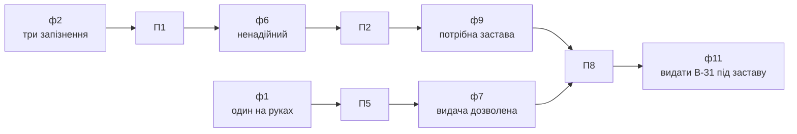
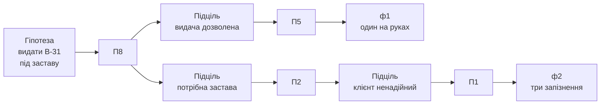
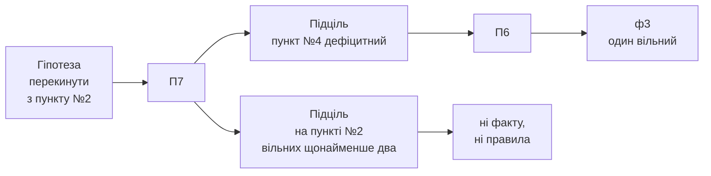

# Зразок бази правил і прогонів виведення

Зразок до лабораторної роботи №5 курсу «Організація баз даних і знань». Демонстраційна область - мережа прокату велосипедів; база правил і обидва прогони взято з [лекції 10](../../lectures/lecture-10.md).

Файл показує оформлення кроків 1-5 методичних вказівок, а не готову відповідь: правила, факти й прогони власної предметної області складаються заново. Скопійована і перейменована база правил прокату роботою не є.

## Крок 1. База правил прокату

| № | ЯКЩО умова | ТО висновок |
|---|---|---|
| П1 | клієнт повернув велосипед із запізненням більше ніж двічі за календарний місяць | клієнт ненадійний |
| П2 | клієнт ненадійний | для видачі потрібна застава |
| П3 | у клієнта на руках два велосипеди або більше | клієнт на ліміті |
| П4 | клієнт на ліміті | видачу заборонено |
| П5 | у клієнта на руках менше двох велосипедів | видача дозволена |
| П6 | на пункті вільних велосипедів менше двох | пункт дефіцитний |
| П7 | пункт дефіцитний **і** на сусідньому пункті вільних велосипедів щонайменше два | перекинути велосипед із сусіднього пункту |
| П8 | видача дозволена **і** потрібна застава | видати велосипед під заставу |

- Правила, що спираються на висновки інших: П2 (на П1), П4 (на П3), П7 (на П6), П8 (на П5 і П2).
- Правило зі складеною умовою: П7 і П8 - обидва з двох частин через «і».
- Пара правил із протилежними висновками: П4 «видачу заборонено» і П5 «видача дозволена». Розведені за величиною «кількість велосипедів на руках»: межа проходить між одним і двома, тому обидва висновки разом зʼявитися не можуть.

## Крок 2. Джерело кожної умови

| Правило | Умова | Джерело |
|---|---|---|
| П1 | запізнень за місяць більше двох | `rentals.rented_at` і `rentals.returned_at` разом із тарифом видачі: запізнення - перевищення строку, на який велосипед видано |
| П2 | клієнт ненадійний | висновок П1 |
| П3 | на руках два велосипеди або більше | `rentals` з `returned_at IS NULL` для клієнта |
| П4 | клієнт на ліміті | висновок П3 |
| П5 | на руках менше двох велосипедів | `rentals` з `returned_at IS NULL` для клієнта |
| П6 | вільних велосипедів менше двох | `bikes.station_name` і `rentals` з `returned_at IS NULL` |
| П7 | пункт дефіцитний | висновок П6 |
| П7 | на сусідньому пункті вільних щонайменше два | сусідства в реляційній схемі немає - це звʼязок `NEIGHBOUR_OF` графа знань |
| П8 | видача дозволена | висновок П5 |
| П8 | потрібна застава | висновок П2 |

- Правил, що спираються лише на початкові факти: чотири (П1, П3, П5, П6 - в умові лише дані).
- Правил, що спираються на висновки інших: чотири (П2, П4, П7, П8).
- Умова, даних для якої в схемі немає: «на сусідньому пункті». Сусідство пунктів не зберігалося в жодній таблиці робіт №1-3; у PostgreSQL для нього знадобилася б окрема таблиця пар пунктів, а питання «сусіди сусідів» - зʼєднання цієї таблиці з самою собою.

## Крок 3. Прогін 1

Ситуація: клієнт К-114 просить велосипед B-31 на пункті №4.

| № | Факт |
|---|---|
| ф1 | у клієнта К-114 на руках один велосипед |
| ф2 | К-114 повернув велосипед із запізненням тричі за березень |
| ф3 | на пункті №4 вільний один велосипед, B-31 |
| ф4 | на пункті №7 вільні два велосипеди |
| ф5 | пункти №2 і №7 сусідні до пункту №4 |

Конфліктний набір першого циклу: П1, П5, П6. Правило П3 не спрацьовує, бо на руках один велосипед, а не два. Порядок застосування - за номером правила.

| Цикл | Правило | Новий факт |
|---|---|---|
| 1 | П1 | ф6: К-114 ненадійний |
| 1 | П5 | ф7: видача дозволена |
| 1 | П6 | ф8: пункт №4 дефіцитний |
| 2 | П2 (за ф6) | ф9: потрібна застава |
| 2 | П7 (за ф8 і ф4) | ф10: перекинути велосипед із пункту №7 на пункт №4 |
| 3 | П8 (за ф7 і ф9) | ф11: видати B-31 клієнтові К-114 під заставу |
| 4 | - | - |

- Фактів на початку: 5. Фактів наприкінці: 11.
- Не спрацювали жодного разу: П3 і П4. Це не помилка: база правил описує всі ситуації області, а прогін - одну; для клієнта з одним велосипедом на руках правила про ліміт не застосовні. Тривожним був би протилежний випадок - ситуація, у якій не спрацювало жодне правило.
- Про пункт №2 правило П7 мовчить: кількості вільних велосипедів на ньому ніхто не назвав.

## Крок 3. Прогін 2

Ті самі вісім правил, інші факти.

| № | Факт |
|---|---|
| ф1 | у клієнта К-310 на руках два велосипеди |
| ф2 | запізнень у К-310 за березень не було |
| ф3 | на пункті №4 вільний один велосипед, B-31 |

Конфліктний набір першого циклу: П3, П6.

| Цикл | Правило | Новий факт |
|---|---|---|
| 1 | П3 | ф4: К-310 на ліміті |
| 1 | П6 | ф5: пункт №4 дефіцитний |
| 2 | П4 (за ф4) | ф6: видачу заборонено |
| 3 | - | - |

- Фактів на початку: 3. Фактів наприкінці: 6.
- Не спрацювали: П1, П2, П5, П7, П8. Застава не знадобилася - до правила П2 виведення не дійшло, бо П1 не спрацювало; П7 не спрацювало, бо про сусідні пункти цього разу фактів немає.
- Правила не змінювалися - змінилися факти, і висновок став протилежним. Саме тому правила зберігають окремо від фактів.

## Крок 4. Ланцюжок виведення прогону 1

Висновок ф11 «видати B-31 клієнтові К-114 під заставу».

- Спрацювало, але в ланцюжок не ввійшло: факти ф3, ф4, ф5 і правила П6, П7 - вони дали висновок ф10 про перекидання велосипеда, до цього висновку не дотичний.
- Пояснення для замовника: велосипед видати можна, бо на руках у клієнта лише один, але із заставою, бо за березень він тричі повернув велосипед із запізненням.

## Крок 5. Зворотне виведення

Гіпотеза, яка підтверджується: «видати B-31 клієнтові К-114 під заставу».

- Не знадобилися: П3, П4, П6, П7 - до гіпотези вони не ведуть.
- Обсяг роботи: прямий прогін перебирав вісім правил, зворотне виведення перевірило чотири.

Гіпотеза, яка не підтверджується: «перекинути велосипед із пункту №2 на пункт №4».

- Гілка обривається на підцілі «на пункті №2 вільних щонайменше два»: ні факту з такою відповіддю, ні правила з таким висновком немає.
- Відповідь «ні» означає тут «нічого не відомо», а не «відомо, що ні»: діє припущення замкнутого світу - хибним вважається все, чого немає ні серед фактів, ні серед висновків правил.
- Небезпека для замовника: система мовчить про пункт №2 так само впевнено, як про пункт, де велосипедів справді немає, і відрізнити два випадки за відповіддю неможливо.
- У SQL (лекція 7) те саме місце займало третє значення «невідомо»: саме через нього умова NOT IN не була істинною, якщо підзапит повертав хоча б один NULL.
